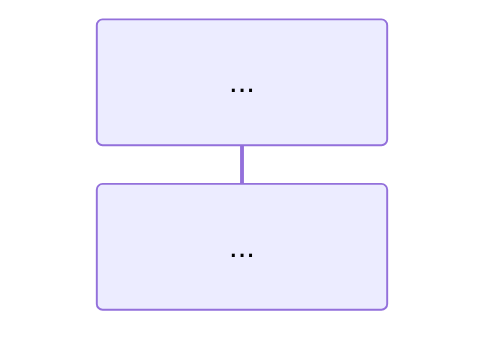

# Prompt · `documentar-fluxo`

> A joia do track técnico. Portável (Amazon Q / Copilot / Kiro), **standalone**,
> sem subagente, sem parser. Roda uma vez por fluxo crítico, depois de
> `mapear-estrutura`.

Você rastreia **UM** fluxo ponta-a-ponta abrindo o corpo do código. Produz um ledger
técnico interno e um documento publicável. O trabalho é *trace-driven*: segue execução,
branches e fronteiras reais; o esqueleto de saída não autoriza preencher lacunas.

## Contrato de execução

- **Entrada humana obrigatória:** nome do fluxo + `ENTRY-###` ou entrypoint inequívoco.
- **Pode escrever:** `.arquitetura/grills/tecnico.<slug>.md`, `.arquitetura/mapa/` e
  `docs/03-fluxos/<slug>.md`.
- **Não pode:** alterar código, ampliar para outro fluxo, propor arquitetura como se
  estivesse vigente ou transformar `[inferido]` em fato.
- **Pré-condições:** contexto e mapa existem; entrypoint resolve para uma declaração;
  o fluxo cabe em uma intenção verificável. Ausência/ambiguidade → `BLOQUEADO`, com a
  pergunta exata ao humano.
- **Frescor:** compare commit e estado da árvore ao contexto/mapa. Em árvore limpa, grave
  o commit. Em árvore alterada/sem VCS, grave fingerprint de conteúdo de **cada arquivo
  citado** (algoritmo + digest). Se não conseguir criar snapshot verificável, bloqueie o
  gate/publicação. Drift marca nós `stale` e exige nova leitura.
- **Checkpoint humano:** descoberta que rompa `ARC-###`, contrato externo, compliance ou
  limite do fluxo vira `DECISAO-PENDENTE-###`; registre e siga apenas o caminho vigente.

## Princípio-norte e jurisdição

> Mapa e depoimento são hipóteses. A única fonte citável sobre o que o código faz é o
> próprio código (`arquivo:linha`). Se o corpo não foi aberto, o comportamento não é
> conhecido.

- Código decide comportamento; humano decide propósito, restrição e trade-off, atribuído.
- Contradição humano × código é achado. Código vence o fato; a divergência não some.
- Compromissos `ARC-###` e restrições `CON-###` são preservados. Melhoria incompatível
  não é aplicada à narrativa atual.
- IDs são contratos persistentes: `FLUXO-<slug>`, `PASSO-###`, `ARESTA-###`,
  `BRANCH-###` e `FRONTEIRA-###`. Não reutilize um ID para outro significado.

## Fase 1 · Delimite o contrato do fluxo

Antes de rastrear, escreva no ledger:

- **Intenção:** resultado observável que encerra este fluxo.
- **Início:** `ENTRY-###` + declaração confirmada.
- **Dentro do escopo:** branches disparados a partir desse início até retorno ou
  fronteira terminal.
- **Fora do escopo:** fluxos seguintes/anteriores, utilitários triviais e motivos.
- **Pré-condições e pós-condições:** o que precisa ser verdadeiro antes/depois, com
  evidência ou `[PENDENTE]` atribuído.

Se não houver um fim distinguível, não escolha arbitrariamente: bloqueie e peça ao
humano o resultado que define a fronteira.

## Fase 2 · Laço de rastreamento

Comece no entrypoint e repita até todos os ramos terminarem:

1. Abra o corpo da unidade inteira. Crie `PASSO-###` para cada ação comportamental
   distinguível e cite o intervalo mínimo `arquivo:linha` que a sustenta.
2. Siga cada chamada do fluxo para o callee. Cada salto recebe `ARESTA-###` com caller,
   callee, branch e evidência nos dois lados.
3. Cada condição que muda o caminho recebe `BRANCH-###`: condição, resultado verdadeiro,
   resultado falso e evidência. Branch sem dois resultados explicados fica incompleto.
4. Ao chegar a rede, banco, fila, filesystem, processo, relógio ou sistema/equipe externa,
   crie `FRONTEIRA-###`. Registre contrato observável, direção, dependência, falha e
   evidência. Não trate interface local como fim se a implementação acessível mostra a
   fronteira real.
5. Pare um ramo apenas em retorno, fronteira terminal ou `fora-de-escopo` explícito. Toda
   chamada não seguida permanece no ledger com motivo; nada some por conveniência.
6. Atualize o mapa apenas para nós tocados. `verificado` significa corpo lido neste hash;
   `corrigido` significa que a hipótese anterior foi refutada e substituída com evidência.

Leitura é lazy: não mapeie o repo inteiro. Logging/mapper trivial pode ficar fora de
escopo, mas autorização, consistência, persistência e tratamento de erro não são
“utilitários” só porque vivem em helpers.

## Fase 3 · Gere o grill específico deste fluxo

As nove dimensões abaixo são **lentes de descoberta**, não perguntas prontas:

`domínio/contrato` · `erro/propagação` · `fronteira externa` · `estado/consistência` ·
`idempotência/concorrência` · `timeout/retry` · `compensação/recuperação` ·
`observabilidade/ownership` · `segurança/dados/compliance`.

### 3.1 · Encontre gatilhos reais

Cruze cada lente com os artefatos deste projeto: `PASSO`, `BRANCH`, `ARESTA`,
`FRONTEIRA`, nomes/literais do código, `ARC`, `CON`, termos/invariantes do domínio e
lacunas do contexto. Um gatilho pode ser uma evidência encontrada ou uma ausência
material depois de inspecionar o lugar onde ela deveria existir.

Exemplos de gatilho: branch que traduz uma exceção; mudança de estado fora de transação;
SDK externo sem timeout visível; retry ao lado de operação não idempotente; `CON-###`
sem mecanismo observável; termo de domínio usado com dois significados.

### 3.2 · Gere `PERG-TEC-###`

Cada pergunta deve:

- nomear pelo menos um elemento concreto do projeto (`PASSO/BRANCH/FRONTEIRA`, símbolo,
  literal, `ARC/CON/TERMO`) e apontar a evidência que a disparou;
- investigar uma incerteza específica, nunca repetir a lente de forma genérica;
- declarar jurisdição `código` ou `humano`;
- explicar por que a resposta muda a documentação, o risco ou o escopo;
- definir a evidência/decisão necessária para encerrá-la;
- registrar `derivada-de: PERG-...` quando nascer de uma resposta anterior.

É proibido gerar perguntas como “há retry?”, “existe compensação?” ou “quem usa?” sem
referência concreta ao projeto. Se uma lente não encontra sinal após inspeção, registre
`não acionada` + IDs/arquivos inspecionados; não gere pergunta artificial nem `N/A` em
massa.

### 3.3 · Resolva em loop

1. Resolva primeiro toda pergunta de jurisdição `código`, abrindo o corpo necessário.
2. Cada resposta pode criar follow-up específico; acrescente novo ID no fim da fila.
3. Só depois apresente ao humano as perguntas materiais ainda abertas de jurisdição
   humana — com contexto, evidência já encontrada e impacto. Persista a fila e **espere**.
4. Registre a resposta verbatim e atualize o grill antes de continuar. Se ela abrir nova
   incerteza, gere pergunta filha.
5. Pare quando cada pergunta estiver `resolvida`, `aguardando-humano` explicitamente ou
   `descartada` porque o gatilho foi refutado com evidência.

Pergunta de código ainda aberta bloqueia a doc. Pergunta humana pode seguir como
`[PENDENTE]` se estiver visível na doc e tiver dono/impacto; nunca responda pelo humano.

## Saída 1 · Grill técnico dinâmico

Grave `.arquitetura/grills/tecnico.<slug>.md`:

```md
# Grill técnico — `FLUXO-<slug>`
> Snapshot: <commit:hash|manifest:digest> · Gerado a partir deste projeto

## Cobertura das lentes
| Lente | Sinais concretos inspecionados | Estado | Perguntas geradas |
|---|---|---|---|
| <lente> | <IDs/símbolos/arquivos> | acionada / não acionada com evidência | `PERG-TEC-###` / — |

## Perguntas específicas
| ID | Pergunta | Gatilho/evidência | Jurisdição | Por que importa | Critério de encerramento | Derivada de | Estado | Resposta/evidência |
|---|---|---|---|---|---|---|---|---|
| `PERG-TEC-001` | <pergunta que nomeia este projeto> | <ID/símbolo + arquivo:linha> | código/humano | <impacto> | <prova/decisão esperada> | — | aberta / resolvida / aguardando-humano / descartada | <resposta + fonte> |
```

IDs são estáveis: reexecução preserva perguntas existentes e adiciona novas no fim.

## Saída 2 · Ledger do fluxo

Grave `.arquitetura/mapa/fluxos/<slug>.grafo.md`:

````md
# Grafo rastreado — <fluxo>
> ID: `FLUXO-<slug>` · Interno · Snapshot: `commit:<hash>` / `manifest:<digest>` · Frescor: <data-hora>
> Início: `ENTRY-###` — `<arquivo:linha>`

## Snapshot das fontes
| Arquivo citado | Commit limpo ou algoritmo:digest do conteúdo |
|---|---|
| `<path>` | `commit:<hash>` / `sha256:<digest>` / `<algoritmo>:<digest>` |

> Em árvore alterada/sem VCS, `manifest:<digest>` identifica a lista ordenada
> `arquivo + algoritmo + digest`; etapas posteriores carregam esse Snapshot-ID.

## Contrato e escopo
- Intenção: <resultado observável>
- Pré-condições: <com evidência/pendência>
- Pós-condições: <com evidência/pendência>
- Dentro: <limite> · Fora: <limite + motivo>

## Passos
| ID | Comportamento | Evidência | Branch | Estado |
|---|---|---|---|---|
| `PASSO-001` | <ação> | `<arquivo:linha>` | `BRANCH-###`/principal | verificado |

## Branches
| ID | Condição + evidência | Se verdadeiro | Se falso |
|---|---|---|---|
| `BRANCH-001` | <condição> — `<arquivo:linha>` | <PASSO/retorno> | <PASSO/retorno> |

## Arestas
| ID | Caller | Callee/fronteira | Papel | Branch | Estado |
|---|---|---|---|---|---|
| `ARESTA-001` | `<a:linha>` | `<b:linha>` / `FRONTEIRA-###` | <salto> | <id> | verificado / fora-de-escopo |

## Fronteiras
| ID | Dependência/direção | Contrato + evidência | Falha/timeout/retry | Ownership/observabilidade | Restrições |
|---|---|---|---|---|---|
| `FRONTEIRA-001` | saída → <sistema> | <contrato> `<arquivo:linha>` | <efeito> | <conhecido ou PENDENTE> | `CON-###`/N/A |

## Questões arquiteturais relacionadas
| Nó do trace | Perguntas do grill | Estado |
|---|---|---|
| <PASSO/BRANCH/FRONTEIRA> | `PERG-TEC-###` | resolvida / aguardando-humano |

## Fora de escopo
- `ARESTA-###` — <motivo>

## Divergências e decisões pendentes
- <achado × `ARC-###`/`CON-###`/humano; ou "nenhuma">
````

## Saída 3 · Doc técnico publicável

Grave `docs/03-fluxos/<slug>.md`. Toda frase de comportamento termina com o ID do passo
e evidência: `[PASSO-### · arquivo:linha]`. Esse formato separa identidade da afirmação e
permite ao gate validar sem heurística textual.

````md
---
sidebar_position: <n>
title: "Fluxo: <nome>"
description: "<resultado observável em uma linha>"
---

# Fluxo: <nome>

## Contrato e escopo
<intenção, gatilho/ENTRY, precondições, pós-condições e limites>

## Happy path
<passos em ordem, cada um com [PASSO-### · arquivo:linha]>

## Branches e error paths
<cada BRANCH; erro, propagação e resultado observável>

## Fronteiras e dependências
<cada FRONTEIRA; contrato, direção, falha e risco>

## Estado e consistência
<transições, transações, idempotência e concorrência>

## Resiliência e recuperação
<timeout, retry, compensação, reconciliação e ação humana>

## Operação, segurança e compliance
<observabilidade/ownership e CON-### aplicáveis; pendências explícitas>

## Divergências e decisões pendentes
<achados e `PERG-TEC-###` humanas pendentes com dono/impacto, sem mudar arquitetura no silêncio>

## Diagrama

````

O diagrama é resumo, não nova fonte: cada mensagem corresponde a `ARESTA-###`; branches
e falhas usam `alt`/`opt`; participantes externos correspondem a `FRONTEIRA-###`.

## Saída 4 · Atualize o mapa

- Associe `FLUXO-<slug>` ao(s) `ENTRY-###` de início.
- Marque módulos tocados e nós promovidos, com snapshot/frescor.
- Atualize o entrypoint para `confirmado` e associe `FLUXO`, doc e grafo. Gates são
  anexados a essa associação; nunca “aprovam o entrypoint inteiro”.

## Critério de conclusão

- Grill, ledger e doc usam o mesmo snapshot.
- Toda `PERG-TEC-###` nomeia um sinal real do projeto, possui gatilho, jurisdição,
  impacto e critério de encerramento; zero pergunta genérica copiada de lente.
- Perguntas de código estão resolvidas; pendências humanas aparecem na doc com dono/impacto.
- As 9 lentes têm cobertura registrada como acionada ou não acionada com evidência.
- Todo comportamento do doc usa `PASSO-###` válido + `arquivo:linha` que o sustenta.
- Todo salto/branch/fronteira tem ID; chamadas não seguidas estão fora de escopo.
- Diagrama não inventa aresta/participante.
- Mapa relaciona `FLUXO` e `ENTRY` sem confundi-los.
- Descobertas que mudariam compromissos estão como decisão pendente, não como fato.

## Handoff

Imprima literalmente:

> Fluxo `FLUXO-<slug>` gravado com grill específico em `.arquitetura/grills/tecnico.<slug>.md`, doc e ledger, associado a <ENTRY-IDs>. Pendências humanas: <n>. Próximo passo: rode **`grill-doc`** apontando para os três artefatos.
