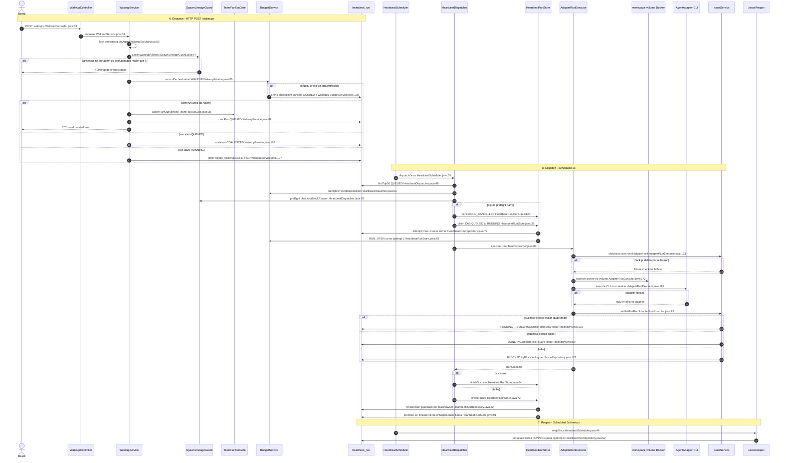

# Fluxo: Wakeup → Run → Settle

O ciclo central de orquestração: acordar um Agent, executar um Run no motor e liquidar a Issue.
Todo caminho relativo à raiz do repo (`backend/src/main/java/com/orquestrador/`).

:::note
Citações ancoradas ao commit `d20f55f` — reproduza com `git show d20f55f:<arquivo>`. (O working tree do repo pode ter drift; o commit é imutável.)
:::

> **É assíncrono, com três entrypoints desacoplados pela fila `heartbeat_run`.** `POST /wakeups`
> **enfileira** (responde `202` na hora, `WakeupController.java:32`) e **não executa nada em linha**;
> quem executa é o `@Scheduled` do dispatcher (`HeartbeatScheduler.java:38`); um terceiro `@Scheduled`
> recupera runs órfãos (`HeartbeatScheduler.java:43`). Ler o `POST` como "roda o agente" é o primeiro
> erro que a passada rasa comete.

## Gatilho

Três gatilhos alimentam o mesmo ciclo:

- **Enqueue (HTTP):** `POST /api/companies/{companyId}/agents/{agentId}/wakeups`, entrypoint `WakeupController.wake` (`WakeupController.java:33`), responde `202 ACCEPTED` (`WakeupController.java:32`).
- **Dispatch (agendado):** `HeartbeatScheduler.dispatch`, `@Scheduled fixedDelay=1000ms` (`HeartbeatScheduler.java:38-40`).
- **Reaper (agendado):** `HeartbeatScheduler.reap`, `@Scheduled fixedDelay=5000ms` (`HeartbeatScheduler.java:43-45`). O scheduler inteiro é desligável por `orquestrador.scheduling.enabled=false` (`HeartbeatScheduler.java:16`).

## Happy path

### A · Enqueue

1. `WakeupController.wake` valida a associação à company (`WakeupController.java:35`) e delega a `WakeupService.enqueue` (`WakeupController.java:38`). Wakeup de ato humano direto entra com **linhagem raiz** (`WakeupService.java:50-51`).
2. `enqueue` toma um **lock pessimista na linha do Agent** via `findByIdForUpdate` (`WakeupService.java:59`) — é isso que serializa wakeups concorrentes do mesmo Agent e sustenta o coalescing (garante ≤1 Run ativo por Agent, `WakeupService.java:17-20`).
3. Passa pelos guards, **todos antes de criar qualquer coisa** (rollback total se barram): linhagem (`WakeupService.java:68`) e arquiteto (`WakeupService.java:73`).
4. Persiste o `AgentWakeupRequest` (`WakeupService.java:75`) e **cobra `WAKEUP` no ledger de orquestração na abertura**, na conta de quem causou (`WakeupService.java:80` → `BudgetService.recordOrchestration`, `BudgetService.java:76`).
5. Busca runs ativos do Agent (`WakeupService.java:82`) e decide:
   - **Sem run ativo** → checa o cap de fan-out (`WakeupService.java:88`), cria o Run `QUEUED` (`WakeupService.java:89`), grava o evento `RUN_QUEUED` (`WakeupService.java:92`) e responde `created=true` (`WakeupService.java:93`).
   - **Run ativo `QUEUED`** → **coalesce**: mescla, adota a Issue se o Run não tinha (`WakeupService.java:99-100`), marca o wakeup `COALESCED` (`WakeupService.java:102`), `created=false`.
   - **Run ativo `RUNNING`/`RECOVERING`** → **defer**: marca `needs_followup` (`WakeupService.java:107`) e o wakeup `DEFERRED` (`WakeupService.java:108`), a ser atendido por um Run seguinte.

### B · Dispatch

6. O tick de 1s chama `HeartbeatDispatcher.dispatchOnce` (`HeartbeatDispatcher.java:47`), que carrega até 50 runs `QUEUED` mais antigos primeiro (`HeartbeatDispatcher.java:49`).
7. Para cada run, roda **quatro preflights** (a segunda face de cada guard, para runs que entraram "por fora" do enqueue): budget (`HeartbeatDispatcher.java:53`), arquiteto (`HeartbeatDispatcher.java:61`), fan-out (`HeartbeatDispatcher.java:68`) e linhagem (`HeartbeatDispatcher.java:75`). Qualquer um que barre → `store.cancel` marca o run `CANCELLED` + evento `RUN_CANCELLED` (`HeartbeatRunStore.java:123-126`).
8. **Claim por CAS**: `store.claim` (`HeartbeatRunStore.java:39`) roda o UPDATE guardado `QUEUED→RUNNING` com `attempt = attempt + 1`, `leaseOwner` e lease de 2 min (`HeartbeatRunRepository.java:66-72`; lease em `HeartbeatDispatcher.java:30`). Se casar 0 linhas, outro worker pegou → segue (`HeartbeatDispatcher.java:81-82`). No claim, cobra `RUN_OPEN` **só se `attempt == 1`** (`HeartbeatRunStore.java:47-48`) — a re-execução do reaper é o mesmo ato e não recobra.
9. Monta o `RunContext` (`HeartbeatDispatcher.java:87`; run sumido após o claim → `IllegalStateException`, `HeartbeatDispatcher.java:88`) e chama `executor.execute` (`HeartbeatDispatcher.java:89`), embrulhado em try/catch que vira `RunOutcome.failure` (`HeartbeatDispatcher.java:90-92`).
10. `AdapterRunExecutor.execute` (`AdapterRunExecutor.java:83`) chama `runToOutcome` (`AdapterRunExecutor.java:103`), que:
    - resolve o workspace (`AdapterRunExecutor.java:113`) e materializa o SkillSet (`AdapterRunExecutor.java:115`) **antes do checkout**;
    - faz o **checkout atômico da Issue com o próprio `runId`** (`AdapterRunExecutor.java:123` → `IssueService.checkout`, `IssueService.java:64`), que adquire o lock via `tryCheckout` (`IssueRepository.java:61`) — o UPDATE só casa se `execution_lock_run_id is null or = :runId` (`IssueRepository.java:59`);
    - escreve a árvore materializada **no volume Docker** pelo seam do `ExecutionTarget` (`AdapterRunExecutor.java:172`);
    - **chama o CLI do agente no container** — `adapter.execute` (`AdapterRunExecutor.java:195`);
    - roteia os tokens reais emitidos para o ledger com `costCents=0` (`AdapterRunExecutor.java:208` → `BudgetService.recordCost`, `BudgetService.java:58`);
    - devolve `RunOutcome.success()` (`AdapterRunExecutor.java:226`) ou `failure` no primeiro tropeço.

### C · Settle

11. De volta em `execute`, se `issueId != null`, chama **`settleAfterRun`** (`AdapterRunExecutor.java:98` → `IssueService.java:99`). Toda saída terminal liquida a Issue, sempre liberando o lock:
    - **sucesso + `risk_level ≥ limiar`** → `submitForReview` estaciona em **`PENDING_REVIEW`** (`IssueService.java:102-103` → `trySubmitForReview`, `IssueRepository.java:101`);
    - **sucesso + risco baixo** → **`DONE`** via `tryComplete` (`IssueService.java:105` → `IssueRepository.java:80`);
    - **falha** → **`BLOCKED`** via `tryBlock` + evento `ISSUE_BLOCKED` (`IssueService.java:108-116` → `IssueRepository.java:122`).
12. O dispatcher finaliza o Run: `finishSuccess` (`HeartbeatRunStore.java:64`) ou `finishFailure` (`HeartbeatRunStore.java:72`), ambos via `finalizeRun` **guardado por `leaseOwner`** (`HeartbeatRunRepository.java:80`) — só o detentor do lease finaliza. Se chegaram wakeups durante o Run, **promote-on-finalize** cria o Run seguinte herdando a **linhagem mais funda** dos deferidos (`HeartbeatRunStore.java:91,102-107`).

## Error paths

Cada caminho abaixo foi confirmado no código; nenhum é hipótese.

- **Agent inexistente / de outra company** no enqueue → `NotFoundException` (`WakeupService.java:60,62`).
- **Loop de orquestração** (acordar ancestral da própria linhagem) ou **cadeia funda demais** (profundidade > 5) → `409 ConflictException`, antes de criar (`SpawnLineageGuard.java:48-55`; `MAX_DEPTH=5` em `SpawnLineageGuard.java:24`).
- **Time sem arquiteto** → `409` no enqueue (`WakeupService.java:73`) e cancelamento no preflight do dispatcher (`HeartbeatDispatcher.java:61-62`).
- **Fan-out no teto** → `409` no enqueue (`TeamFanOutGate.java:44-48`) e cancelamento no preflight (`HeartbeatDispatcher.java:68-69`).
- **Budget com incidente OPEN** → nada novo nasce: preflight cancela o run com "budget hard-stop" (`HeartbeatDispatcher.java:53-54` → `BudgetService.invocationBlocked`, `BudgetService.java:48`).
- **Run nascido ilegal por fora do enqueue** (promote-on-finalize com linhagem já ilegal) → cancelado no checkout (`HeartbeatDispatcher.java:75-77` → `SpawnLineageGuard.checkoutBlockReason`, `SpawnLineageGuard.java:63`).
- **Agent removido entre o enqueue e o dispatch** → o executor não acha o Agent → `failure` (`AdapterRunExecutor.java:104-106`).
- **Checkout perde a corrida** (Issue já em execução por outro run) → `RunOutcome.failure` "checkout falhou" (`AdapterRunExecutor.java:124-125`).
- **Falha ao materializar SkillSet** (antes do checkout, não deixa a Issue travada) → `failure` (`AdapterRunExecutor.java:117-118`).
- **Falha ao escrever o workspace no volume** → `failure` legível (`AdapterRunExecutor.java:176-180`).
- **Adapter lança** → `failure` "falha no adapter" (`AdapterRunExecutor.java:196-200`).
- **Review sobre run sintético/alheio** → `409 ConflictException` + rollback total, Issue segue `IN_PROGRESS` com o lock (`IssueService.java:134-137`).
- **Settle de um run que não detém a Issue** → guard casa 0 linhas → `NOT_SETTLED`, a Issue-vítima fica intacta (`IssueService.java:105-106,108-109`).
- **Config inválida:** `risk-threshold` fora de 1-5 **derruba o boot** com mensagem clara, em vez de desligar o gate em silêncio (`IssueService.java:36-40`).

## Chamadas externas

- **PostgreSQL** — toda a máquina de estados (fila `heartbeat_run`, Issue, cost_events, incidentes) é UPDATE guardado no banco; se o banco cai, claim/finalize/settle falham a transação e o run não avança.
- **Volume Docker do workspace** — `ExecutionTarget.writeWorkspaceFiles` (`AdapterRunExecutor.java:172`): no Docker o backend **não enxerga** o workspace direto; escrever atravessa o seam. Falha aqui é `failure` do run (`AdapterRunExecutor.java:176-180`).
- **CLI do agente no container** — `adapter.execute` (`AdapterRunExecutor.java:195`): o motor real (Claude Code / Codex / process) roda a imagem pinada do adapter com só a credencial do plano montada. É a fronteira mais cara e a que mais falha (credencial expirada, timeout do CLI) → `failure` (`AdapterRunExecutor.java:196-200`).

## Transições · idempotência · timeout/retry · compensação

**Transições de estado.**
- Run: `QUEUED` → `RUNNING` (claim CAS, `HeartbeatRunRepository.java:66-72`) → `SUCCEEDED`/`FAILED` (finalize guardado por owner, `HeartbeatRunRepository.java:77-80`); ou `QUEUED` → `CANCELLED` (preflight, `HeartbeatRunStore.java:124`); ou `RUNNING` → `QUEUED` (reaper, `HeartbeatRunRepository.java:87-90`).
- Issue: `IN_PROGRESS` (checkout, `IssueRepository.java:51-53`) → `DONE` (`IssueRepository.java:73`) | `PENDING_REVIEW` (`IssueRepository.java:93`) | `BLOCKED` (`IssueRepository.java:114`), todas liberando `execution_lock_run_id` (`IssueRepository.java:74,94,115`).

**Idempotência.**
- **Coalescing**: o lock pessimista do Agent (`WakeupService.java:59`) garante ≤1 Run ativo; wakeups repetidos viram `COALESCED`/`DEFERRED`, não Runs duplicados (`WakeupService.java:96-109`).
- **Claim CAS**: só um worker vira `QUEUED→RUNNING` (`HeartbeatRunRepository.java:70`), multi-nó-safe.
- **Lock da Issue**: `tryCheckout` é reentrante para o mesmo run (`is null or = :runId`, `IssueRepository.java:59`); `tryComplete`/`tryBlock`/`trySubmitForReview` exigem `execution_lock_run_id = :runId` (`IssueRepository.java:78,98,119`) — um run intruso liquida 0 linhas.
- **RUN_OPEN uma vez só**: cobrado apenas em `attempt == 1` (`HeartbeatRunStore.java:47`).

**Timeout / retry.**
- Lease de 2 min por claim (`HeartbeatDispatcher.java:30`); worker que morre deixa o lease vencer. O reaper devolve `RUNNING` com lease vencido para `QUEUED` (`HeartbeatRunRepository.java:87-90`), o dispatcher re-claima e o `attempt` incrementa (`HeartbeatRunRepository.java:69`). **Sem auto-retry de Issue**: uma Issue `BLOCKED` espera decisão humana (REOPEN/CANCEL), fora deste fluxo.

**Compensação.**
- **Drena até o checkpoint**: ao estourar o orçamento, abre incidente 1×/escopo e **cancela só o que não começou** — runs `QUEUED` + wakeups pendentes (`BudgetService.java:136-143`) — enquanto o `RUNNING` termina o passo e liquida no settle (`BudgetService.java:14-21`). O preflight garante que nenhum sucessor nasce (`BudgetService.java:48`). Matar `RUNNING` no banco nunca matou o processo — só jogaria fora trabalho pago.
- **Guard `limitCents > 0`**: um teto ≤ 0 não é um limite executável; sem o guard, `spent(0) ≥ limit(0)` abriria incidente na primeira emissão inócua (`costCents=0`) e cancelaria o escopo (`BudgetService.java:94-98`).

## Divergências (achados)

Nenhuma. O depoimento do operador (o `CONTEXT.md` do repo) bateu com o código em todos os pontos verificados — inclusive nos "padrões que não se aplicam" (o adapter, não o modelo, escolhe o plano; linhagem é causalidade; sem auto-retry). Onde o `CONTEXT.md` afirma comportamento (ex.: "settleAfterRun … sempre liberando o lock, guardado por `execution_lock_run_id`"), a afirmação foi confirmada no código (`IssueRepository.java:78,98,119`) e citada por `arquivo:linha`, não pelo depoimento.

## Fora de escopo (arestas não seguidas — decisão registrada)

Cada uma é **fluxo próprio**, a documentar em seu doc; a aresta que as aciona está coberta acima, mas o corpo interno não foi aberto (lazy):

- **Gate de composição do arquiteto** (`TeamService.assertDispatchAllowed` / `dispatchBlocked`, ADR-0017).
- **Resolver e materializer de workspace/skills** (`WorkspaceResolver`, `SkillMaterializer`, F.9).
- **Captura de preview e servidor** (`PreviewArtifactCapturer`, `PreviewServerManifestRegistrar`, `PreviewServerSupervisor`, F.9/F.10).
- **Turno de conversa** — a variante de Run **sem Issue** (`ConversationTurnCoordinator`, T.3).
- **Guard de segurança** de acesso à company (`CompanyAccessGuard.assertMember`).

## Diagrama

